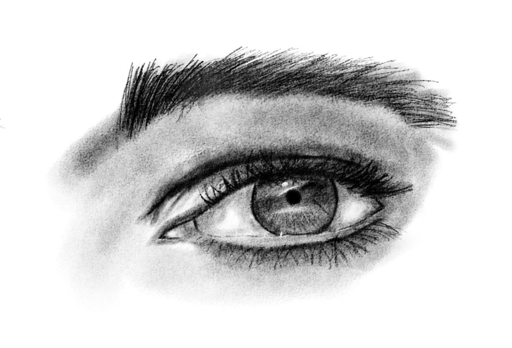

:::: {.about-grid}

::: {.about-text}
Hello, I'm Samuel. I'm a data analyst with a background in statistics, and I'm interested in presenting mathematics educationally.

The idea is to select niche mathematical topics (physics, statistics, pure maths) and present them such that someone without mathematical experience can find enjoyment, but those with the know-how can get deeper understanding. Mathematics doesn’t have to be boring, we just need to make it palatable.

Besides mathematics, I am also interested in philosophy. Writing on philsophy has been a recurring pasttime for me, and if time permits for proofreading (as many essays remain in an embarassingly unreadable state), I may publish some of my personal digests.

My personal interests in philosophy (interests doesn't necessarily imply agreement) hover loosely around political theory, metaethics (existentialism and positivism) and theology (Karl Barth, Augustine, Aquinas)
::: 

::: {.about-photo}
{.nolightbox fig-alt="Photo of Samuel"}
:::

::::

Shoutout to my favorite band **ZUTOMAYO** who created this masterpiece. 
