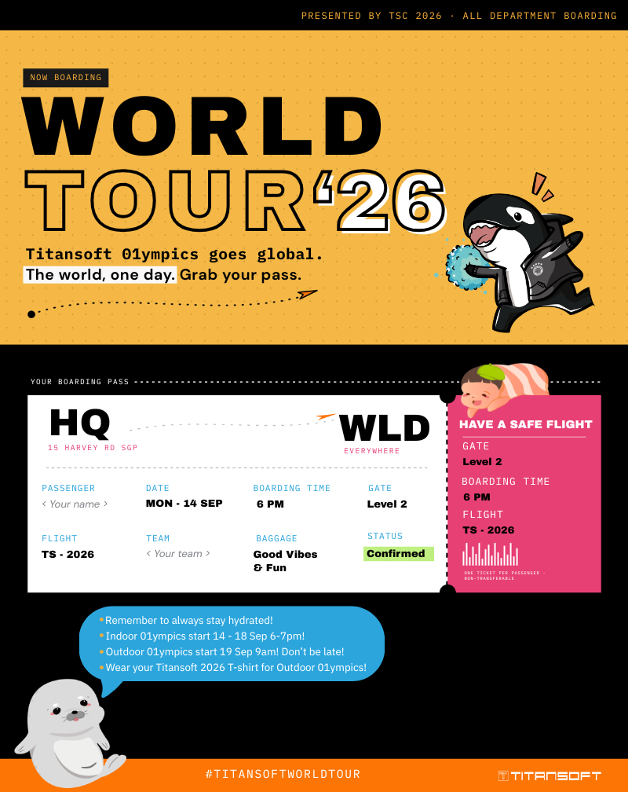

{group="gallery" description="A short caption for this photo."}

{group="gallery" description="Another caption."}

{group="gallery" description="Caption three."}

<!--
To add a new photo:
1. Drop the image file into images/gallery/
2. Add a new line above in the same format:
   {group="gallery" description="Caption."}
3. The grid and lightbox (click-to-enlarge) are automatic — no other changes needed.
-->
