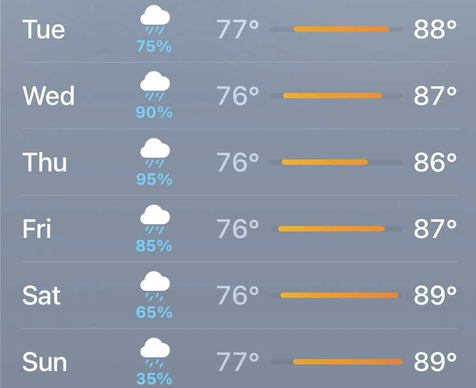
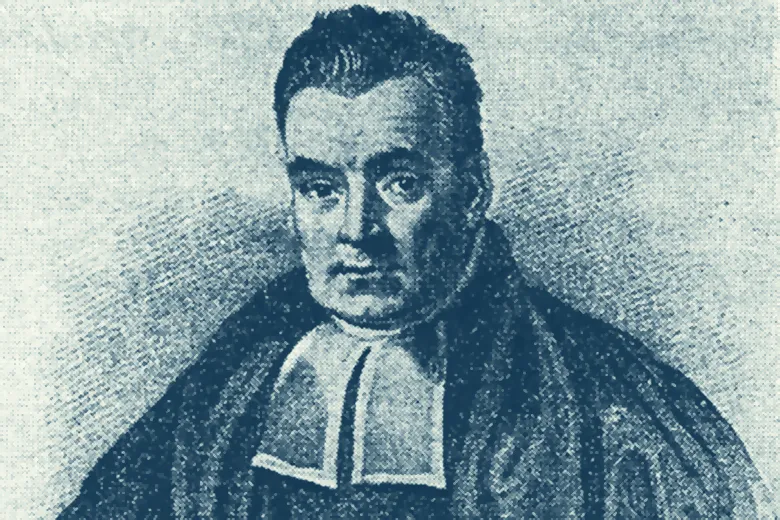

<!-- 
I still remembered my Intro to Bayesian Analysis course, and that period of my life was a fond memory. It was spring and right outside the dorm, there are the cherry trees. A whole forest of them. They were part of this landscaping project, by virtue of an alumni, and have now became a university's staple. The student newspaper would track the blossom dates meticulously and everyone would just come to this part of the campus to look at the trees. They were all waiting, and I was too. And one day, the blossoms had started. It was a spectacular full bloom. They were pink and vibrant. Even smelled great too. Looking at them from the window gave me a sense of longing - of how nice it must be to share that patch under the tree with another person. But there isn't anyone at the time and the only person who would was too far. -->

## Introduction

Here's a simple question: *"What is the probability that it will rain tomorrow?"*



You might think that this is a no-brainer. Open your weather app and there it is: **75%**. But what does that 75% actually mean?

Think about how we usually make sense of probability. When we say a fair coin has a 50% chance of landing heads, we mean that if we flip it hundreds or thousands of times, roughly half the flips will be heads. This is the definition behind the statistics most of us met in Stats 101, with its z-tables and p-values: probability is how often something happens when you repeat it. We call this *frequentist probability*.

:::{.callout-note collapse="false"}
## The frequentist definition of probability
Consider an experiment that can be repeated indefinitely under identical conditions, with each repetition independent of the others. Let $A$ be an event, and let $N_A(n)$ be the number of times $A$ occurs in the first $n$ repetitions. The frequentist probability of $A$ is the limiting relative frequency:

$$
P(A) = \lim_{n \to \infty} \frac{N_A(n)}{n}
$$

:::

```{python}
#| fig-cap: "Proportion of heads over 10,000 flips of a fair coin."
import numpy as np
import matplotlib.pyplot as plt
from matplotlib.animation import FuncAnimation
from IPython.display import HTML

plt.rcParams.update({
    "figure.dpi": 110,
    "figure.autolayout": True,
    "axes.spines.top": False,
    "axes.spines.right": False,
    "axes.titlesize": 9,
})

def proportion_plot(xlabel, ylabel):
    fig, ax = plt.subplots(figsize=(7, 4))
    ax.set(xscale="log", xlabel=xlabel, ylabel=ylabel)
    ax.xaxis.set_major_formatter("{x:,.0f}")
    ax.yaxis.set_major_formatter("{x:.0%}")
    ax.grid(alpha=0.3)
    return ax

flips = np.random.default_rng(4).integers(0, 2, size=10_000)  # 1 = head, 0 = tail
n = np.arange(1, flips.size + 1)

ax = proportion_plot("Number of flips (log scale)", "Proportion of heads")
ax.plot(n, flips.cumsum() / n, color="blue", linewidth=1.5, label="Proportion of heads")
ax.axhline(0.5, color="gray", linestyle="--", linewidth=1, label="50%")
ax.set_ylim(0, 1)
ax.legend(frameon=False)
plt.show()
```

That 50% doesn’t promise a clean half in any particular batch. Ten flips could give seven heads; a thousand might give 480. What it promises is that the more you flip, the closer the proportion drifts toward 50%. On this view, probability is a statement about the long run. That makes it intuitive for coins, dice and cards, where we can repeat the experiment as often as we like.

The problem comes when we try to answer the question from earlier:

*"What is the probability that it will rain tomorrow?"*

First, tomorrow can happen exactly once. Second, it either rains, or it doesn't. So not only are there no other tomorrows to be repeated, there is no other answer beyond yes or no. So what does the 75% mean?

```{python}
#| fig-cap: "Proportion of rainy tomorrows, over all the tomorrows we can observe."
ax = proportion_plot("Number of tomorrows observed (log scale)", "Proportion of rainy tomorrows")
ax.plot(1, 1, "o", markersize=8, color="blue", label="Proportion of rainy tomorrows")
ax.axhline(0.75, color="gray", linestyle="--", linewidth=1, label="75% (weather app)")
ax.set(xlim=(0.7, 10_000), ylim=(0, 1.05))
ax.legend(frameon=False, loc="lower right")
plt.show()
```

The usual workaround is to rephrase the question: 

*“What is the probability that it will rain on days **like** tomorrow?”*

But which days count as **“like tomorrow”**? Days in October? Days with clouds this thick? October days with clouds this thick and wind from the east? Each choice gives a different answer, and theory doesn't tell you which is right.

Yet, when the app shows 75%, we understand it perfectly well. Think about how we interpret the usual weather report: Nobody pictures a thousand imaginary tomorrows. What we instead think of is **how sure we should be that it will rain on the one tomorrow we’re actually going to get.**

This is a different idea of probability: it's a degree of certainty, which involves having a prior knowledge and a certainty that shifts as new evidence comes in. Wake up to dark clouds, and your 75% might creep up to 90%. Check the radar and see the storm veering away, and it drops.

This idea goes back to the 1760s, to an English minister named Thomas Bayes, and was developed further by the French mathematician Pierre-Simon Laplace. Today it carries Bayes’s name: *Bayesian probability*.



For most of its history, though, it had two problems. Critics attacked its reliance on prior knowledge as unscientific. Worse still, the arithmetic became impossible for the problems that mattered, because the computation explodes with every unknown you add. For nearly two centuries, Bayesian methods were confined to the simplest problems and pushed to the margins of statistics. 

What brought them back from the grave was a method called *Markov Chain Monte Carlo*, or MCMC.

To see why it works, we’ll first look at how Bayesian probability turns a hunch into number and evidence into updates. Then why that update becomes hopeless to compute as complexity grows. And finally, how the solution came from an unlikely place: a random walk. Ending with an answer to this unintuitive question:

**How could wandering around at random crack a problem that defeated mathematicians for two hundred years?**

## Making Sense of Bayes
```{python}
theta = np.linspace(0, 1, 101)  # 0%, 1%, ..., 100%
weather = "RRDRRRRDRRRDRRRRRDRRRRDRRDRRRD"  # 23 rain, 7 dry
prior = np.full_like(theta, 1 / theta.size)

def update(prior, days):
    rain = days.count("R")
    unnormalised = prior * theta**rain * (1 - theta)**(len(days) - rain)
    Z = unnormalised.sum()
    return unnormalised / Z, Z

posterior, _ = update(prior, weather)
ymax = posterior.max() * 1.15

def plot_candidates(values, colour, title, ymax=None, ax=None):
    ax = ax or plt.subplots(figsize=(5, 3))[1]
    ax.bar(theta, values, width=0.007, color=colour)
    ax.set(title=title, xlim=(0, 1), ylim=(0, ymax), yticks=[],
           xlabel=r"$\theta$, chance of rain on an October day")
    ax.xaxis.set_major_formatter("{x:.0%}")
    return ax

def set_heights(bars, heights):
    for bar, h in zip(bars, heights):
        bar.set_height(h)

def animate(fig, draw, steps, hold=3):
    draw(steps[-1])
    fig.tight_layout()
    fig.set_layout_engine("none")
    anim = FuncAnimation(fig, draw, frames=[*steps] + [steps[-1]] * hold, interval=500)
    plt.close(fig)
    return HTML(anim.to_jshtml(default_mode="loop"))
```

Let's start small. Forget tomorrow for a moment, and suppose you've just moved to a new city at the start of October. You know nothing about its weather and it could very well be anything. I hear you ask: Does it rain seven out of ten days? Or one in ten? Let's try to answer that.

Call that unknown $\theta$ (theta): the share of October days that rain, in the long run. It's a property of the city's climate, like its average temperature, and seven in ten would be $\theta = 70\%$.

But there's a problem when trying to measure the probability of $\theta$. $\theta$ is a fixed fact, and to a frequentist a fixed fact can't have a probability. Either it is 70% or it isn't. So we have to reinterpret it under a Bayesian view. You don't *know* $\theta$, and that's uncertainty. Since in Bayesian view, probability is a measure of uncertainty, $\theta$ can have a probability now.

So what does your uncertainty about $\theta$ look like? It isn't a single number. It's a spread of plausibility over every value $\theta$ could take. To keep things simple, let's only consider whole percents: $\theta$ could be 0%, 1%, 2%, and so on up to 100%. That's 101 candidates, and your belief is just how much plausibility you give to each one.

Since you genuinely have no idea, the honest place to start is to spread your belief evenly, giving each of the 101 candidates an equal share. This starting belief is called the *prior*.

```{python}
#| fig-cap: "Each bar is one of the 101 candidates. As all candidates are equally likely, the prior is flat. Such a graph is also called a distribution."
plot_candidates(prior, "gray", "Prior", ymax=ymax)
plt.show()
```

### Updating our prior with evidence

Suppose on the first day of October, it actually rained. How does that change our belief?

We first ask every candidate the same question: *if this was the true $\theta$, how surprised would I be by a rainy day?* 

If $\theta = 90\%$, hardly at all, since rain was 90% likely. If $\theta = 10\%$, quite surprised, since rain was only 10% likely. To put a number on our surprise, we rate each candidate. After a rainy day, each value of $\theta$ gets a rating of $\theta$. After a dry day, it gets $1-\theta$. We call this rating the *likelihood*: how well each candidate predicted what you actually saw.

::: {.callout-tip collapse="false"}
## Why is it $1-\theta$ for a dry day?
Each day either rains or it doesn't, so the two chances must add up to 100%. If rain has a 90% chance, a dry day has a 10% chance. In general, $P(\text{dry}) = 1 - P(\text{rain}) = 1 - \theta$.
:::

For every candidate, you now hold two numbers: how plausible it seemed **before** the rain, and how well it predicted the rain. And we combine them to update our belief.

Imagine 10,100 copies of the city, 100 for each candidate, and let the first of October happen in all of them. Where $\theta = 90\%$, about 90 cities get rain; where $\theta = 10\%$, about 10 do. Since it did rain, cross out every dry city. The two candidates were tied before, but now $\theta = 90\%$ is nine times likelier.

Its 90 survivors are $90/10{,}100 \approx 0.89\%$ of all cities, which is exactly its prior ($1/101$) times its likelihood ($0.9$). In general, each candidate's share of surviving cities is prior $\times$ likelihood, and we call this the *unnormalized posterior*.

```{python}
#| fig-cap: 'After one rainy day, each candidate keeps prior $\times$ likelihood of all the cities. $\theta=0%$ is ruled out as it has no wet days.'
ax = plot_candidates(theta * prior, "green", "Unnormalized posterior - in one day")
ax.yaxis.set_major_locator(plt.MultipleLocator(0.005))
ax.yaxis.set_major_formatter("{x:.1%}")
ax.set_ylabel("share of all cities")
plt.show()
```

There's one last bit of bookkeeping. These shares don't add up to 100%. Instead they add up to 50%, as half the cities were crossed out. So this isn't a belief yet (A probabilty is strictly 0% to 100%). To make it one, divide every share by the total that survived with:

$$
Z = \sum_{k=0}^{100} \text{prior}_k \times \text{likelihood}_k = 0.5.
$$

$Z$ is called the *normalizing constant*, or the *evidence*. It's the fraction of cities that saw what you saw. Dividing by it gives the *posterior*:

```{python}
#| fig-cap: 'Updated belief after seeing one rainy day.'
ax = plot_candidates(update(prior, weather[0])[0], "blue", "Posterior - in one day", ymax=ymax)
ax.yaxis.set_major_locator(plt.MultipleLocator(0.01))
ax.yaxis.set_major_formatter("{x:.0%}")
ax.set_ylabel("belief")
plt.show()
```

### A month of weather

Now keep going. On the second of October, your belief after day one becomes the new prior, and the same counting happens again with that day's weather. Then again on the third, and so on through the month. Each day multiplies in another factor of $\theta$ or $1-\theta$. So a month with 23 rainy days and 7 dry ones gives a likelihood of

$$
p(D \mid \theta) = \theta^{23}\,(1-\theta)^{7},
$$

where $D$ stands for the data, those 30 days of weather. Only the candidates that predicted the whole month reasonably well have cities left. Your belief narrows into a hump around 75%.

<!-- ```{python}
#| fig-cap: "The likelihood of 23 rainy days out of 30, for each candidate."
likelihood = theta**23 * (1 - theta)**7
plot_candidates(likelihood / likelihood.max(), "darkorange", "Likelihood - after a month")
plt.show()
``` -->

<!-- Only the candidates that predicted the whole month reasonably well have cities left. Your belief narrows into a hump around 75%. -->

```{python}
#| fig-cap: "The posterior after 30 days. It's so *normal*, **or is it actually?**"
plot_candidates(posterior, "blue", "posterior - after a month", ymax=ymax)
plt.show()
```

Written out, that's all of Bayes' theorem:

$$
\underbrace{p(\theta \mid D)}_{\text{posterior}}
= \frac{\overbrace{p(D \mid \theta)}^{\text{likelihood}} \times \overbrace{p(\theta)}^{\text{prior}}}{\underbrace{Z}_{\text{evidence}}}
,
\qquad
Z = \sum_{k=0}^{100} p(D \mid \theta_k)\, p(\theta_k)
$$

And here is how the whole system evolve:

```{python}
#| fig-cap: "Prior: today's prior is yesterday's posterior. Likelihood: how good is the prediction given an observation. prior x likelihood: the unnormalized posterior, current total adds up to $Z$ so it is not a belief yet. Posterior: the new updated belief given an observation, normalized by $Z$."
fig, axes = plt.subplots(2, 2, figsize=(7, 5.5), sharex=True)
for ax, colour in zip(axes.flat, ["gray", "darkorange", "purple", "blue"]):
    plot_candidates(np.zeros_like(theta), colour, "", ymax=ymax, ax=ax)
for ax in axes[0]:
    ax.set_xlabel("")
axes[0, 1].set(ylim=(0, 1.1), yticks=[0, 1])
axes[1, 1].set_title("Posterior: divided each by Z, adds up to 1")
header = fig.suptitle("", fontsize=10)

def draw(n):
    rainy = weather[n - 1] == "R"
    before, _ = update(prior, weather[:n - 1])
    likelihood = theta if rainy else 1 - theta
    after, Z = update(before, weather[n - 1])
    for ax, values in zip(axes.flat, [before, likelihood, before * likelihood, after]):
        set_heights(ax.containers[0], values)
    axes[0, 0].set_title(f"Prior: belief after day {n - 1}")
    axes[0, 1].set_title(f"Likelihood of a {'rainy' if rainy else 'dry'} day: "
                         + (r"$\theta$" if rainy else r"$1-\theta$"))
    axes[1, 0].set_title(f"Prior × likelihood: adds up to Z = {Z:.2f}")
    rain = weather[:n].count("R")
    header.set_text(f"Day {n} ({'rain' if rainy else 'dry'}):  {rain} rainy, {n - rain} dry so far")

animate(fig, draw, range(1, len(weather) + 1), hold=2)
```

:::{.callout-note collapse=true}
## The mathematics behind our calculations.
**Setup.** The candidates and the flat prior:

$$
\Theta = \{0, 0.01, \dots, 1\}, \qquad \theta_k = \frac{k}{100}, \quad k = 0, \dots, 100,
\qquad
\theta \sim \mathrm{Unif}(\Theta) \;\Rightarrow\; p(\theta_k) = \frac{1}{101}.
$$

The weather on day $t$ is $x_t \in \{0, 1\}$ for $t = 1, \dots, 30$, with $x_t = 1$ for rain and $x_t = 0$ for no rain. Given $\theta_k$, the days are independent and each is a Bernoulli trial, so our likelihood is $x_t \mid \theta_k \sim \mathrm{Bern}(\theta_k)$:

$$
p(x_t \mid \theta_k) = \theta_k^{x_t}(1-\theta_k)^{1-x_t},
\qquad
p(x_1, \dots, x_n \mid \theta_k) = \prod_{i=1}^{n} p(x_i \mid \theta_k).
$$

The unnormalized posterior, the normalizing constant and the posterior are

$$
\begin{aligned}
\tilde p(\theta_k \mid x_1, \dots, x_n) &= p(x_1, \dots, x_n \mid \theta_k)\, p(\theta_k), \\
Z &= \sum_{k=0}^{100} p(x_1, \dots, x_n \mid \theta_k)\, p(\theta_k), \\
p(\theta_k \mid x_1, \dots, x_n) &= \frac{\tilde p(\theta_k \mid x_1, \dots, x_n)}{Z}.
\end{aligned}
$$

**Day 1: rain ($x_1 = 1$).**

$$
\begin{aligned}
\text{Prior:} \quad & p(\theta_k) = \frac{1}{101} \\
\text{Likelihood:} \quad & p(x_1 \mid \theta_k) = \theta_k^{1}(1-\theta_k)^{0} = \theta_k = \frac{k}{100} \\
\text{Unnormalized posterior:} \quad & \tilde p(\theta_k \mid x_1) = p(x_1 \mid \theta_k)\, p(\theta_k) = \frac{k}{100} \cdot \frac{1}{101} = \frac{k}{10100} \\
\text{Normalizing constant:} \quad & Z = \sum_{k=0}^{100} \frac{k}{10100} = \frac{1}{10100} \sum_{k=0}^{100} k = \frac{1}{10100} \left( \frac{100 \cdot 101}{2} \right) = 0.5 \\
\text{Posterior:} \quad & p(\theta_k \mid x_1) = \frac{\tilde p(\theta_k \mid x_1)}{Z} = \frac{k}{5050}
\end{aligned}
$$

**Day 2: rain ($x_2 = 1$).** Yesterday's posterior is today's prior.

$$
\begin{aligned}
\text{Prior:} \quad & p(\theta_k \mid x_1) = \frac{k}{5050} \\
\text{Likelihood:} \quad & p(x_2 \mid \theta_k) = \theta_k^{1}(1-\theta_k)^{0} = \theta_k = \frac{k}{100} \\
\text{Unnormalized posterior:} \quad & \tilde p(\theta_k \mid x_1, x_2) = p(x_2 \mid \theta_k)\, p(\theta_k \mid x_1) = \frac{k}{100} \cdot \frac{k}{5050} = \frac{k^2}{505000} \\
\text{Normalizing constant:} \quad & Z = \sum_{k=0}^{100} \frac{k^2}{505000} = \frac{1}{505000} \left( \frac{100 \cdot 101 \cdot 201}{6} \right) = 0.67 \\
\text{Posterior:} \quad & p(\theta_k \mid x_1, x_2) = \frac{\tilde p(\theta_k \mid x_1, x_2)}{Z} = \frac{k^2}{338350}
\end{aligned}
$$

The same posterior also follows from the flat prior and both days at once. Substitute $p(\theta_k \mid x_1) = p(x_1 \mid \theta_k)\,p(\theta_k)/p(x_1)$, and $p(x_1)$ cancels:

$$
\begin{aligned}
p(\theta_k \mid x_1, x_2)
&= \frac{p(x_2 \mid \theta_k)\, p(\theta_k \mid x_1)}{\sum_{j=0}^{100} p(x_2 \mid \theta_j)\, p(\theta_j \mid x_1)} \\
&= \frac{p(x_2 \mid \theta_k)\, p(x_1 \mid \theta_k)\, p(\theta_k) \,/\, \cancel{p(x_1)}}{\sum_{j=0}^{100} p(x_2 \mid \theta_j)\, p(x_1 \mid \theta_j)\, p(\theta_j) \,/\, \cancel{p(x_1)}}.
\end{aligned}
$$

**Day $n$.** The prior is $p(\theta_k \mid x_1, \dots, x_{n-1})$ and the likelihood is $p(x_n \mid \theta_k)$, so

$$
\begin{aligned}
p(\theta_k \mid D)
&= \frac{p(x_n \mid \theta_k)\, p(\theta_k \mid x_1, \dots, x_{n-1})}{\sum_{j=0}^{100} p(x_n \mid \theta_j)\, p(\theta_j \mid x_1, \dots, x_{n-1})} \\
&= \frac{p(x_n \mid \theta_k)\, p(x_1, \dots, x_{n-1} \mid \theta_k)\, p(\theta_k) \,/\, \cancel{p(x_1, \dots, x_{n-1})}}{\sum_{j=0}^{100} p(x_n \mid \theta_j)\, p(x_1, \dots, x_{n-1} \mid \theta_j)\, p(\theta_j) \,/\, \cancel{p(x_1, \dots, x_{n-1})}} \\
&= \frac{\prod_{i=1}^{n} p(x_i \mid \theta_k)\; p(\theta_k)}{\sum_{j=0}^{100} \left( \prod_{i=1}^{n} p(x_i \mid \theta_j) \right) p(\theta_j)}.
\end{aligned}
$$

In general, the posterior is

$$
p(\theta_k \mid D) = \frac{L(\theta_k; D)\, p(\theta_k)}{\sum_{j=0}^{100} L(\theta_j; D)\, p(\theta_j)},
\qquad
L(\theta_k; D) = p(D \mid \theta_k) = \prod_{i=1}^{n} p(x_i \mid \theta_k) \text{ by independence}.
$$

Take $n = 30$ and we recover our distribution.
:::

### From a belief to a forecast

Back to the question we actually care about: will it rain tomorrow given we have observed 30 days of data?

To make a forecast, we treat each candidate as an expert and ask them for the chance of rain. The $\theta = 60\%$ expert says 60%, the $\theta = 90\%$ expert says 90%, and so on. However, it would be a mistake to trust all candidates equally because not all of them are equally likely to be right. 

To account for this, we rely on the posterior which tells us how much to believe each candidate, given the data. So we weight every expert's answer by our belief in them. This gets us a new distribution called the *posterior predictive distribution*. We can then add up all the belief, amd since the weights add up to 100%, we get a weighted average which is our forecast.

$$
P(\text{rain tomorrow at day 31} \mid D) = \sum_{k=0}^{100} \underbrace{p(\text{rain tomorrow at day 31} \mid \theta_k)}_{\theta_k} \; p(\theta_k \mid D) = 0.75
$$

```{python}
#| fig-cap: 'Blue: the posterior, adds up to 100%. Purple: each candidate''s vote for rain, $\theta_k \times p(\theta_k \mid D)$, adds up to the 75% forecast.'
ax = plot_candidates(posterior, "blue", "Posterior vs. posterior predictive", ymax=ymax)
for bar in ax.containers[0]:
    bar.set_alpha(0.3)
ax.containers[0].set_label(f"posterior (sum = {posterior.sum():.0%})")
plot_candidates(theta * posterior, "purple", "Posterior vs. posterior predictive", ymax=ymax, ax=ax)
ax.containers[1].set_label(f"posterior predictive (sum = {(theta * posterior).sum():.0%})")
ax.yaxis.set_major_locator(plt.MultipleLocator(0.01))
ax.yaxis.set_major_formatter("{x:.0%}")
ax.set_ylabel("belief")
ax.legend(frameon=False, loc="upper left")
plt.show()
```

:::{.callout-tip collapse="true"}
## Where the forecast formula comes from?
We write $\tilde y$ for tomorrow's weather, day 31. We have that tomorrow's weather depends on which climate is true, so split over the candidates using the law of total probability

$$
P(\tilde y = \text{rain} \mid D) = \sum_{k=0}^{100} P(\tilde y = \text{rain} \mid \theta_k, D)\; p(\theta_k \mid D)
$$

We treats days as independent given the climate, i.e once you know $\theta_k$, the past month tells you nothing more about tomorrow. So $P(\tilde y = \text{rain} \mid \theta_k, D) = P(\tilde y = \text{rain} \mid \theta_k)$.

Like every other day, tomorrow is a Bernoulli trial with success probability $\theta_k$, so $P(\tilde y = \text{rain} \mid \theta_k) = \theta_k$. 

In general, for continuous $\theta$:

$$
p(\tilde y \mid D) = \int p(\tilde y \mid \theta)\, p(\theta \mid D)\, d\theta
$$
:::

Doing the calculation, we get a forecast that answers our question naturally: *Given what we have observed for the past 30 days, there is a 75% chance that it will rain tomorrow.*

```{python}
#| fig-cap: "Left: the posterior day by day, with the forecast as a dashed line. Right: how the forecast for tomorrow moves as new observations are added."
forecasts = [(theta * update(prior, weather[:n])[0]).sum() for n in range(len(weather) + 1)]

fig, (ax_post, ax_fc) = plt.subplots(1, 2, figsize=(7, 3))
bars = plot_candidates(prior, "blue", "", ymax=ymax, ax=ax_post).containers[0]
forecast_line = ax_post.axvline(0.5, color="black", linestyle="--", linewidth=1)
forecast_text = ax_post.text(0, ymax * 0.9, "", ha="right", fontsize=9)

line, = ax_fc.plot([], [], color="blue")
dot, = ax_fc.plot([], [], "o", color="blue")
label = ax_fc.text(0, 0, "", fontsize=9, ha="center", va="bottom")
ax_fc.set(xlim=(-2, len(weather) + 1), ylim=(0, 1),
          xlabel="days observed", ylabel="forecast for tomorrow")
ax_fc.yaxis.set_major_formatter("{x:.0%}")

def draw(n):
    f = forecasts[n]
    set_heights(bars, update(prior, weather[:n])[0])
    forecast_line.set_xdata([f, f])
    forecast_text.set(position=(f - 0.02, ymax * 0.9), text=f"forecast {f:.0%}")
    ax_post.set_title(f"Posterior after day {n}" if n else "Prior")

    line.set_data(range(n + 1), forecasts[:n + 1])
    dot.set_data([n], [f])
    label.set(position=(n, f + 0.04), text=f"{f:.0%}")
    ax_fc.set_title(f"Forecast after day {n}" if n else "Forecast before any data")

animate(fig, draw, range(len(weather) + 1))
```

:::{.callout-note collapse='false'}
For why we did not use the maximum of the posterior distribution but compute the weighted average instead, see Appendix A.
:::

The forecast is a single number, but the posterior holds far more than that. You can ask it which climates are still plausible, how sure you can be that this is a rainy city, and how many rainy days to expect next week.

Start with the first. To find the range of climates you're 95% sure contains the true one, cut 2.5% of belief from each end of the posterior. Starting from $\theta = 0$, add up belief until you reach 2.5%: that's the lower bound. Keep going until you reach 97.5%: that's the upper bound. The middle holds 95% of your belief, and here it runs from **59% to 88%**.

```{python}
#| echo: false
#| warning: false
#| fig-cap: 'The 95% credible interval holds the middle 95% of your belief about $\theta$. The dashed lines mark where cumulative belief reaches 2.5% and 97.5%, at $\theta$ = 59% and 88%.'
cdf = np.cumsum(posterior)
lo, hi = theta[np.searchsorted(cdf, 0.025)], theta[np.searchsorted(cdf, 0.975)]
inside = (theta >= lo) & (theta <= hi)

fig, ax = plt.subplots(figsize=(7, 3.4))
ax.bar(theta[~inside], posterior[~inside], width=0.008, color="lightsteelblue")
ax.bar(theta[inside], posterior[inside], width=0.008, color="blue")
for x in (lo, hi):
    ax.axvline(x, color="black", linestyle="--", linewidth=0.5)
ax.set_xlim(0, 1)
ax.set_ylim(0, ymax * 1.1)
ax.set_yticks([])
ax.xaxis.set_major_formatter(plt.FuncFormatter(lambda x, _: f"{x:.0%}"))
ax.set_xlabel(r"$\theta$, chance of rain on an October day")
plt.tight_layout()
plt.show()
```

The interval is wide, it's almost 30 percentage point. Well given that we only observed 30 days of weather, being convinced that the city is likely to be rainy but not being able to pin how wet down exactly makes sense.

The interval also means exactly what it sounds like. A 95% credible interval states there's a 95% probability that $\theta$ lies betweeen 59% and 88%. This sounds obvious but the confidence interval, that we learned in Stats 101, can't tell you that.

::: {.callout-note collapse="true"}
## Credible intervals vs confidence intervals

A 95% **confidence interval** is a statement about a *procedure*. If you repeated the experiment many times and built an interval with lower bound $L(X)$ and upper bound $U(X)$ each time, 95% of those intervals would contain the true $\theta$. Any single interval you've computed either contains $\theta$ or it doesn't, so its probability is 0 or 1. What's random is the interval but $\theta$ is fixed.

$$
P_\theta\big(L(X) \le \theta \le U(X)\big) \ge 0.95 \quad \text{for every } \theta
$$

A 95% **credible interval** reverses that. It is a statement about *this* interval, given *this* data:

$$
P(0.59 \le \theta \le 0.88 \mid D) = \sum_{k:\ 0.59 \le \theta_k \le 0.88} p(\theta_k \mid D) \approx 0.95
$$

With this method, we find that we have a 95% probability of where $\theta$ is. The interval is fixed but $\theta$ is random.

Most people read confidence intervals as if they were credible intervals. With plenty of data and a mild prior, the two are often numerically close, a result known as the Bernstein–von Mises theorem [@van1998], which is why the misreading rarely causes trouble. You would be wrong in principle to read a confidence interval as "$\theta$ has a 95% chance to be in this interval", but usually it doesn't matter. However with little data or a strong prior, they can differ substantially.
:::

Suppose now, you want to know whether this is a city where it rains more often than not. In other words, is $\theta$ above 50%? The posterior can answer that directly. We add up the belief on every candidate above 50%:

$$
P(\theta > 50\% \mid D) = \sum_{k:\ \theta_k > 0.5} p(\theta_k \mid D) \approx 99.8\%
$$

So you can be practically sure it's a rainy city. A narrower question, whether $\theta$ is above 80%, comes out at about 25%: possible, but you shouldn't bet on it.

```{python}
#| fig-cap: 'Left: belief that $\theta > 50\%$, the city rains more often than not. Right: belief that $\theta > 80\%$, the city is very wet. Vertical lines show the cuttoff at $\theta = 0.5 \text{ and } 0.8$ respectively.'
fig, axes = plt.subplots(1, 2, figsize=(7, 3), sharey=True)
for ax, cutoff in zip(axes, [0.5, 0.8]):
    above = theta > cutoff
    plot_candidates(np.where(above, 0, posterior), "lightsteelblue", "", ymax=ymax, ax=ax)
    ax.bar(theta[above], posterior[above], width=0.007, color="blue")
    ax.axvline(cutoff, color="black", linestyle="--", linewidth=1)
    ax.set_title(rf"$P(\theta > {cutoff * 100:.0f}\% \mid D) = {posterior[above].sum() * 100:.1f}\%$")
plt.show()
```

This looks like the question a *p-value* answers, but it isn't. A p-value asks: *if* $\theta$ were exactly 50%, how often would a month look at least this rainy? Here the answer is about 0.3%. 

It's tempting to read that as "a 0.3% chance the city isn't rainy," but that isn't what it says. The p-value assumes the hypothesis and asks about the data. The posterior does the reverse: it takes the data as given and tells you how plausible the hypothesis is. With it, we can justifiably say there's a 0.2% chance that the city isn't rainy. 

::: {.callout-note collapse="true"}
## Confused by p-value? Read this. 
A *p-value* starts from a *null hypothesis*, $H_0: \theta \leq 0.5$, against an *alternative hypothesis*, $H_1: \theta > 0.5$. It also needs a test statistic, $T(X)$, the number of rainy days. The p-value is the probability, assuming $H_0$ is true, of seeing data at least as extreme as what you actually saw:

$$
p = P_{\theta \leq 0.5}\big(T(X) \ge T(x)\big) = \sum_{k=23}^{30} \binom{30}{k} (0.5)^{30} \approx 0.0026.
$$

In other words: if rain really fell on exactly half of October days, a month with 23 or more rainy days would turn up only about 0.26% of the time. That's well below the conventional threshold of 0.05, so we reject $H_0$ and conclude the city is quite the rainy one.

Note what p-value doesn't conclude. It doesn't say there's a 0.26% chance that $\theta = 0.5$, or a 99.74% chance that the city is rainy. It only makes a statement about the **data, assuming the hypothesis**!

<!-- This might sound complicated, so here's an analogy.

![*Plucked from the Fairy Circle* by T. H. Thomas [@sikes1880, p. 74].](fairycircle.png)

You wake up to find a perfect ring of mushrooms in your backyard. Folklore says fairies dance in circles and leave rings like this behind. Is there a fairy in your backyard?

A p-value approaches the question by assuming the boring explanation: *there is no fairy*. This is your **null hypothesis**. It then asks: if there really is no fairy, how often would a ring at least this perfect appear anyway, from fungi growing outward in a circle, as they often do?

Suppose you survey the forest and find that fungi alone produce a ring this neat about 40% of the time. That's your p-value, $p = 0.40$. A ring like this is exactly what you'd expect to stumble across with no fairy involved, so it gives you no reason to abandon the boring explanation. You **fail to reject** the null hypothesis.

Note what that does and doesn't mean. Failing to reject isn't the same as accepting. You haven't shown there's no fairy; you've only shown that this ring doesn't need one. By convention, the null is rejected only when $p$ falls below a threshold, usually 0.05, meaning the data would be genuinely surprising if the boring explanation were true. -->

The posterior probability reverses that:

$$
P(\theta \le 0.5 \mid D) = \sum_{k:\ \theta_k \le 0.5} p(\theta_k \mid D) \approx 0.002
$$

Here the data are fixed, and the probability is your belief about $\theta$. Unlike the p-value, we can say there's a 0.2% chance that $\theta \leq 0.5$, or a 99.8% chance that the city is rainy. This is because the posterior makes a statement about the **hypothesis, given the data**.

The two numbers happen to be close here. For a one-sided question with a flat prior, they often are. But they answer different questions, and they can disagree badly. For a sharp hypothesis such as "$\theta$ is *exactly* 50%", a small p-value can sit alongside a high posterior probability that the hypothesis is true, a result known as Lindley's paradox [@lindley1957].
:::

## The numerator problem

