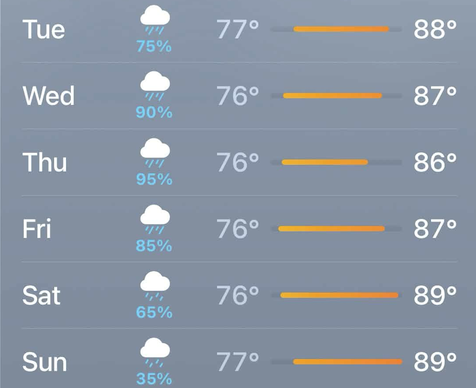

I still remembered my Intro to Bayesian Analysis course, and that period of my life was a fond memory. It was spring and right outside the dorm, there are the cherry trees. A whole forest of them. They were part of this landscaping project, by virtue of an alumni, and have now became a university's staple. The student newspaper would track the blossom dates meticulously and everyone would just come to this part of the campus to look at the trees. They were all waiting, and I was too. And one day, the blossoms had started. It was a spectacular full bloom. They were pink and vibrant. Even smelled great too. Looking at them from the window gave me a sense of longing - of how nice it must be to share that patch under the tree with another person. But there isn't anyone at the time and the only person who would was too far.

## Introduction

Here's a simple question: *"What is the probability that it will rain tomorrow?"*



You might think that this is a no-brainer. Open your weather app and there it is: **$75\%$**. But what does that $75\%$ actually mean?

Think about how we usually make sense of probability. When we say a fair coin has a $50\%$ chance of landing heads, we mean that if we flip it hundreds or thousands of times, roughly half the flips will be heads. This is the definition behind the statistics most of us met in Stats 101, with its z-tables and p-values: probability is how often something happens when you repeat it. We call this *frequentist probability*.

:::{.callout-note collapse="false"}
## The frequentist definition of probability
Consider an experiment that can be repeated indefinitely under identical conditions, with each repetition independent of the others. Let $A$ be an event, and let $N_A(n)$ be the number of times $A$ occurs in the first $n$ repetitions. The frequentist probability of $A$ is the limiting relative frequency:

$$
P(A) = \lim_{n \to \infty} \frac{N_A(n)}{n}
$$

:::

```{python}
#| echo: false
#| warning: false
#| fig-cap: "Proportion of heads over 10,000 flips of a fair coin."
import numpy as np
import matplotlib.pyplot as plt

plt.rcParams.update({"figure.dpi": 110, "axes.spines.top": False, "axes.spines.right": False})

rng = np.random.default_rng(4)
n_flips = 10_000
flips = rng.integers(0, 2, size=n_flips) # 1 = head, 0 = tail
n = np.arange(1, n_flips + 1)
running_ratio = np.cumsum(flips) / n

fig, ax = plt.subplots(figsize=(7, 4))
ax.plot(n, running_ratio, color="blue", linewidth=1.5, label="Proportion of heads")
ax.axhline(0.5, color="gray", linestyle="--", linewidth=1, label="50%")
ax.set_xscale("log")
ax.xaxis.set_major_formatter(plt.FuncFormatter(lambda x, _: f"{x:,.0f}"))
ax.set_ylim(0, 1)
ax.yaxis.set_major_formatter(plt.FuncFormatter(lambda y, _: f"{y:.0%}"))
ax.set_xlabel("Number of flips (log scale)")
ax.set_ylabel("Proportion of heads")
ax.grid(alpha=0.3)
ax.legend(frameon=False)
plt.tight_layout()
plt.show()
```

That $50\%$ doesn’t promise a clean half in any particular batch. Ten flips could give seven heads; a thousand might give 480. What it promises is that the more you flip, the closer the proportion drifts toward $50\%$. On this view, probability is a statement about the long run. That makes it intuitive for coins, dice and cards, where we can repeat the experiment as often as we like.

The problem comes when we try to answer the question from earlier:

*"What is the probability that it will rain tomorrow?"*

First, tomorrow can happen exactly once. Second, it either rains, or it doesn't. So not only are there no other tomorrows to be repeated, there is no other answer beyond yes or no. So what does the $75\%$ mean?

```{python}
#| echo: false
#| warning: false
#| fig-cap: "Proportion of rainy tomorrows, over all the tomorrows we can observe."
fig, ax = plt.subplots(figsize=(7, 4))
ax.plot([1], [1.0], marker="o", markersize=8, color="blue", linestyle="none", label="Proportion of rainy tomorrows")
ax.axhline(0.75, color="gray", linestyle="--", linewidth=1, label="75% (weather app)")
ax.set_xscale("log")
ax.set_xlim(0.7, 10_000)
ax.xaxis.set_major_formatter(plt.FuncFormatter(lambda x, _: f"{x:,.0f}"))
ax.set_ylim(0, 1.05)
ax.yaxis.set_major_formatter(plt.FuncFormatter(lambda y, _: f"{y:.0%}"))
ax.set_xlabel("Number of tomorrows observed (log scale)")
ax.set_ylabel("Proportion of rainy tomorrows")
ax.grid(alpha=0.3)
ax.legend(frameon=False, loc="lower right")
plt.tight_layout()
plt.show()
```

The usual workaround is to rephrase the question: 

*“What is the probability that it will rain on days **like** tomorrow?”*

But which days count as **“like tomorrow”**? Days in October? Days with clouds this thick? October days with clouds this thick and wind from the east? Each choice gives a different answer, and theory doesn't tell you which is right.

Yet, when the app shows $75\%$, we understand it perfectly well. Think about how we interpret the usual weather report: Nobody pictures a thousand imaginary tomorrows. What we instead think of is **how sure we should be that it will rain on the one tomorrow we’re actually going to get.**

This is a different idea of probability: it's a degree of certainty, which involves having a prior knowledge and a certainty that shifts as new evidence comes in. Wake up to dark clouds, and your $75\%$ might creep up to $90\%$. Check the radar and see the storm veering away, and it drops. This idea goes back to the 1760s, to an English minister named Thomas Bayes, and was developed further by the French mathematician Pierre-Simon Laplace. Today it carries Bayes’s name: *Bayesian probability*.


For most of its history, though, it had two problems. Critics attacked its reliance on prior knowledge as unscientific. Worse still, the arithmetic became impossible for the problems that mattered, because the computation explodes with every unknown you add. For nearly two centuries, Bayesian methods were confined to the simplest problems and pushed to the margins of statistics. 

What brought them back from the grave was a method called *Markov Chain Monte Carlo*, or MCMC.

To see why it works, we’ll first look at how Bayesian probability turns a hunch into number and evidence into updates. Then why that update becomes hopeless to compute as complexity grows. And finally, how the solution came from an unlikely place: a random walk. Ending with an answer to this unintuitive question:

**How could wandering around at random crack a problem that defeated mathematicians for two hundred years?**

## Making Sense of Bayes
```{python}
#| echo: false
#| warning: false
theta = np.linspace(0, 1, 101) # 0%, 1%, ..., 100%
weather = "RRDRRRRDRR" "RDRRRRRDRR" "RRDRRDRRRD" # 23 rain, 7 dry

def update(prior, days):
    rain = days.count("R")
    dry = len(days) - rain
    unnormalised = prior * theta**rain * (1 - theta)**dry
    Z = unnormalised.sum()
    return unnormalised / Z, Z

prior = np.full_like(theta, 1 / theta.size)
likelihood = theta**weather.count("R") * (1 - theta)**weather.count("D")
after_one_day, _ = update(prior, weather[0])
posterior, Z = update(prior, weather)
forecast = (theta * posterior).sum()
ymax = posterior.max() * 1.1

def plot_candidates(values, colour, title, ymax=None):
    fig, ax = plt.subplots(figsize=(5, 3.2))
    ax.bar(theta, values, width=0.008, color=colour)
    ax.set_title(title, fontsize=11)
    ax.set_xlim(0, 1)
    if ymax is not None:
        ax.set_ylim(0, ymax)
    ax.xaxis.set_major_formatter(plt.FuncFormatter(lambda x, _: f"{x:.0%}"))
    ax.set_xlabel(r"$\theta$, chance of rain on an October day")
    ax.set_yticks([])
    return ax
```

Let's start small. Forget tomorrow for a moment, and suppose you've just moved to a new city at the start of October. You know nothing about its weather and it could very well be anything. Does it rain seven out of ten days? Or one in ten?

Call that unknown $\theta$ (theta): the share of October days that rain, in the long run. It's a property of the city's climate, like its average temperature, and seven in ten would be $\theta = 70\%$.

But there's a problem when trying to measure the probability of $\theta$. $\theta$ is a fixed fact, and to a frequentist a fixed fact can't have a probability. Either it is 70% or it isn't. So we have to reinterpret it under a Bayesian view. You don't *know* $\theta$, and that's uncertainty. Remember that in the Bayesian view, probability is a measure of uncertainty.

So what does your uncertainty about $\theta$ look like? It isn't a single number. It's a spread of plausibility over every value $\theta$ could take. To keep things simple, let's only consider whole percents: $\theta$ could be $0\%$, $1\%$, $2\%$, and so on up to $100\%$. That's 101 candidates, and your belief is just how much plausibility you give to each one.

Since you genuinely have no idea, the honest place to start is to spread your belief evenly, giving each of the 101 candidates an equal share. This starting belief is called the *prior*.

```{python}
#| echo: false
#| warning: false
#| fig-cap: "Each bar is one of the 101 candidates. As all candidates are equally likely, the prior is flat."
plot_candidates(prior, "gray", "Prior", ymax=posterior.max() * 1.1)
plt.tight_layout()
plt.show()
```

### Updating our prior with evidence

Suppose on the first day of October, it actually rained. How should your belief change?

Ask every candidate the same question: *if this was the true $\theta$, how surprised would I be by a rainy day?* 

If $\theta = 90\%$, hardly at all, since rain was $90\%$ likely. If $\theta = 10\%$, quite surprised, since rain was only $10\%$ likely. To put a number on our surprise, we can rate each candidate. After a rainy day, each value of $\theta$ gets a rating of $\theta$. After a dry day, it gets $1-\theta$. We call this rating the *likelihood*: how well each candidate predicted what you actually saw.

For every candidate, you now hold two numbers: how plausible it seemed **before** the rain, and how well it predicted the rain. And we combine them to update our belief.

Imagine 10,100 copies of the city, 100 for each candidate, and let the first of October happen in all of them. Where $\theta = 90\%$, about 90 cities get rain; where $\theta = 10\%$, about 10 do. Since it did rain, cross out every dry city. The two candidates were tied before, but now $\theta = 90\%$ is nine times likelier. 

Its 90 survivors are $90/10{,}100 \approx 0.89\%$ of all cities, which is exactly its prior ($1/101$) times its likelihood ($0.9$). In general, each candidate's share of surviving cities is prior $\times$ likelihood, and we call this the *unnormalized posterior*.

```{python}
#| echo: false
#| warning: false
#| fig-cap: 'After one rainy day, each candidate keeps prior $\times$ likelihood of all the cities. $\theta=0%$ is ruled out as it has no wet days.'
ax = plot_candidates(theta * prior, "blue", "Unnormalized posterior")
ax.yaxis.set_major_locator(plt.MultipleLocator(0.005))
ax.yaxis.set_major_formatter(plt.FuncFormatter(lambda y, _: f"{y:.1%}"))
ax.set_ylabel("share of all cities")
plt.tight_layout()
plt.show()
```

There's one last bit of bookkeeping. These shares don't add up to $100\%$. They add up to $50\%$, because half the cities were crossed out. So this isn't a belief yet. To make it one, divide every share by the total that survived:

$$
Z = \sum_{k=0}^{100} \text{prior}_k \times \text{likelihood}_k = 0.5.
$$

$Z$ is called the *normalizing constant*, or the *evidence*. It's the fraction of cities that saw what you saw. Dividing by it gives the *posterior*:

```{python}
#| echo: false
#| warning: false
#| fig-cap: 'Updated belief after seeing one rainy day. '
ax = plot_candidates(after_one_day, "blue", "Posterior", ymax=ymax)
ax.yaxis.set_major_locator(plt.MultipleLocator(0.01))
ax.yaxis.set_major_formatter(plt.FuncFormatter(lambda y, _: f"{y:.0%}"))
ax.set_ylabel("belief")
plt.tight_layout()
plt.show()
```

### A month of weather

Now keep going. On the second of October, your belief after day one becomes the new prior, and the same counting happens again with that day's weather. Then again on the third, and so on through the month. Each day multiplies in another factor of $\theta$ or $1-\theta$. So a month with 23 rainy days and 7 dry ones gives a likelihood of

$$
p(D \mid \theta) = \theta^{23}\,(1-\theta)^{7},
$$

where $D$ stands for the data, those 30 days of weather.

```{python}
#| echo: false
#| warning: false
#| fig-cap: "The likelihood of 23 rainy days out of 30, for each candidate."
plot_candidates(likelihood / likelihood.max(), "darkorange", "Evidence: the likelihood")
plt.tight_layout()
plt.show()
```

Only the candidates that predicted the whole month reasonably well have cities left. Your belief narrows into a hump around $75\%$.

```{python}
#| echo: false
#| warning: false
#| fig-cap: "The posterior after 30 days: prior times likelihood, divided by $Z$."
plot_candidates(posterior, "blue", "After a month: the posterior", ymax=ymax)
plt.tight_layout()
plt.show()
```

Written out, that's all of Bayes' theorem:

$$
\underbrace{p(\theta \mid D)}_{\text{after}}
= \frac{\overbrace{p(D \mid \theta)}^{\text{evidence}} \times \overbrace{p(\theta)}^{\text{before}}}{Z},
\qquad
Z = \sum_{k=0}^{100} p(D \mid \theta_k)\, p(\theta_k),
$$
